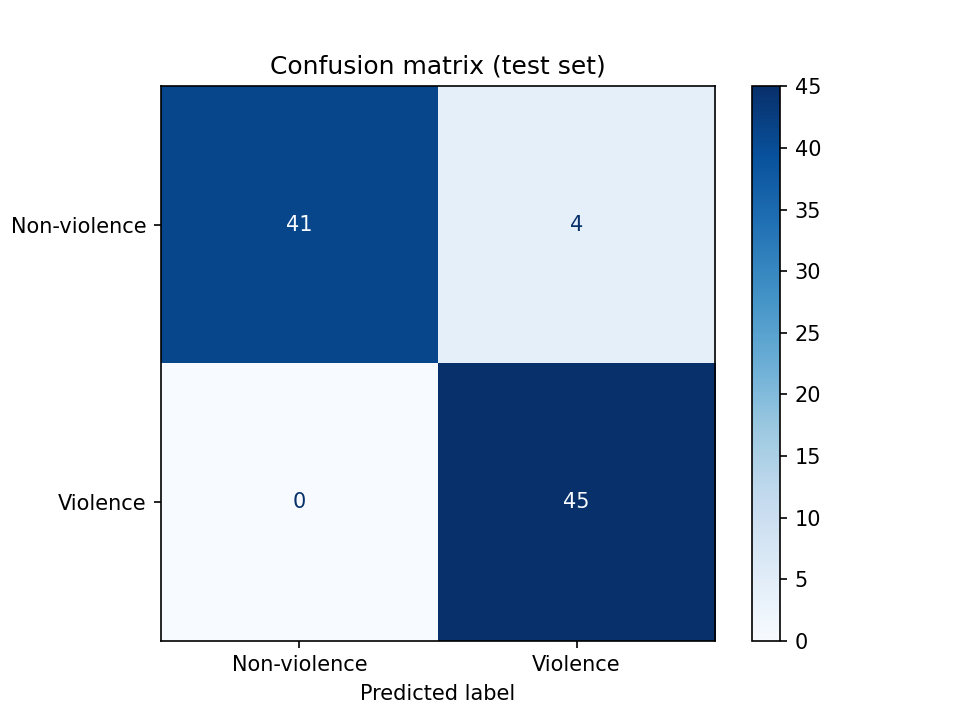
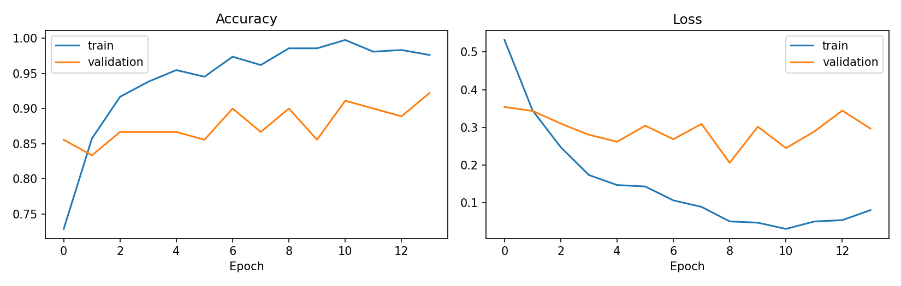

# Violence Detection in Video Clips (CNN + LSTM)

A deep learning project that classifies short video clips as **Violence** or **Non-violence**.

## How it works
1. **OpenCV** samples 16 evenly spaced frames from each video.
2. A pretrained **MobileNetV2** (CNN, ImageNet weights, frozen) turns each frame into a 1280-number feature vector.
3. An **LSTM** reads the 16 feature vectors in order, so it can learn how the scene changes over time.
4. A sigmoid output gives the probability that the clip contains violence.

## Tech stack
Python, OpenCV, TensorFlow/Keras, scikit-learn, NumPy, Matplotlib, Google Colab

## Dataset
Real Life Violence Situations Dataset (Kaggle). I used a balanced subset of **[FILL IN: number]** videos per class, split 70% train, 15% validation and 15% test.

## Results (on videos the model never saw during training)
- Test accuracy: **[FILL IN from your notebook]**
- Precision / recall / F1: **[FILL IN from the classification report]**

## How to run
1. Open `crime_detection.ipynb` in Google Colab.
2. Set the runtime to GPU (Runtime > Change runtime type).
3. Run all cells from top to bottom.

## Limitations
- Trained on a small subset, so results may not carry over to other camera angles, lighting or real CCTV footage.
- It classifies a whole clip and does not locate where in the video the violence happens.
- Many clips in this dataset come from similar sources, so test accuracy may be higher than real-world accuracy.
- This is a learning project and not a real security system.

## Future improvements
Train on more data, fine-tune the CNN, try 3D CNNs or video transformers, and add real-time webcam or stream input.
